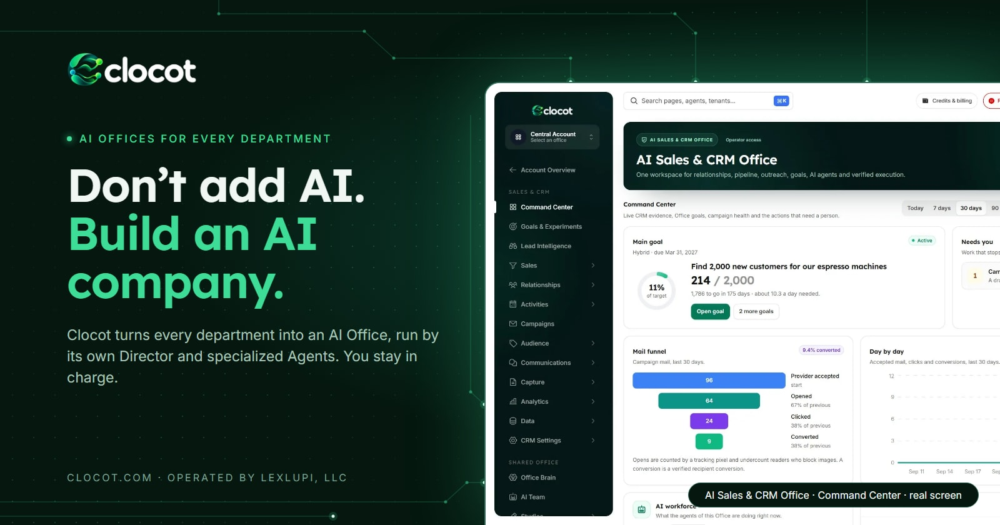
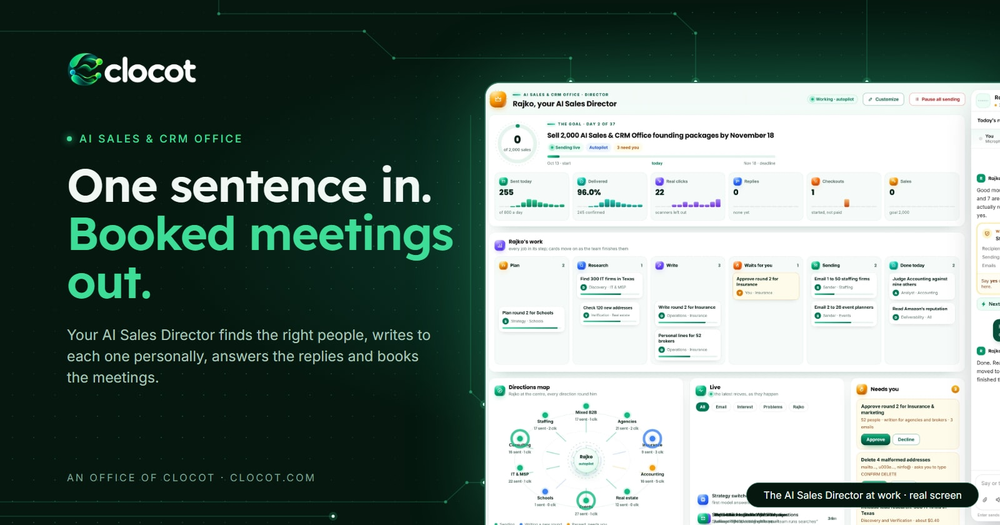
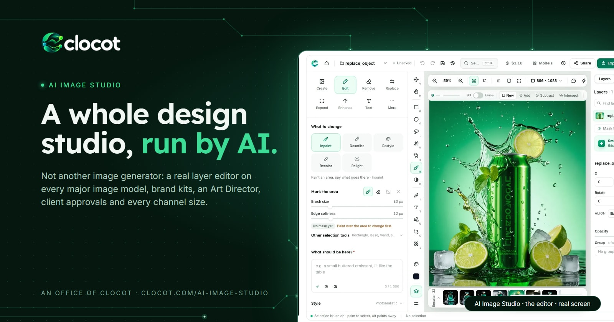

  <a href="https://www.clocot.com"><b>clocot.com</b></a> &nbsp;·&nbsp;
  <a href="https://www.clocot.com/offices"><b>Office library</b></a> &nbsp;·&nbsp;
  <a href="https://www.linkedin.com/company/clocot"><b>LinkedIn</b></a> &nbsp;·&nbsp;
  <a href="https://www.pinterest.com/clocotai"><b>Pinterest</b></a>

## What Clocot is

Most AI tools answer one question at a time. Clocot is built like a company. Each department becomes an **AI Office**, and inside it a **Director** turns your goal into a plan, hands the tasks to specialized **Agents**, checks what comes back and tells you what happened.

Marketing, sales, finance, support, research, legal: each can run as its own Office, and every Office learns from the same memory. It works through the tools you already use, and only as far as you allow.

## Inside every Office

| Director | Agents | Office Brain | Your control |
|---|---|---|---|
| Plans the work, delegates it, checks it and reports back. | Specialized workers that research, write, design, analyse and schedule. | Products, brand, customers, rules and what worked, shared by every Agent. | You set the goal and approve what goes out. |

## Offices

Every Office has its own page:

<table>
<tr>
<td width="50%" valign="top">

<h3><a href="https://github.com/clocot/ai-sales-crm">AI Sales & CRM Office</a></h3>

One sentence in. Booked meetings out.

</td>
<td width="50%" valign="top">

<h3><a href="https://github.com/clocot/ai-image-studio">AI Image Studio</a></h3>

A whole design studio, run by AI.

</td>
</tr>
</table>

More Offices from the library of about 70 (marketing, social media, finance, support, legal, operations and more) get their pages as they open. [Browse the library →](https://www.clocot.com/offices)

## Status

Clocot is a working prototype in active development. The wider Clocot production platform follows in early 2027.

 

Clocot is operated by LexLupi, LLC, a Delaware limited liability company · <a href="mailto:contact@lexlupi.com">contact@lexlupi.com</a>

